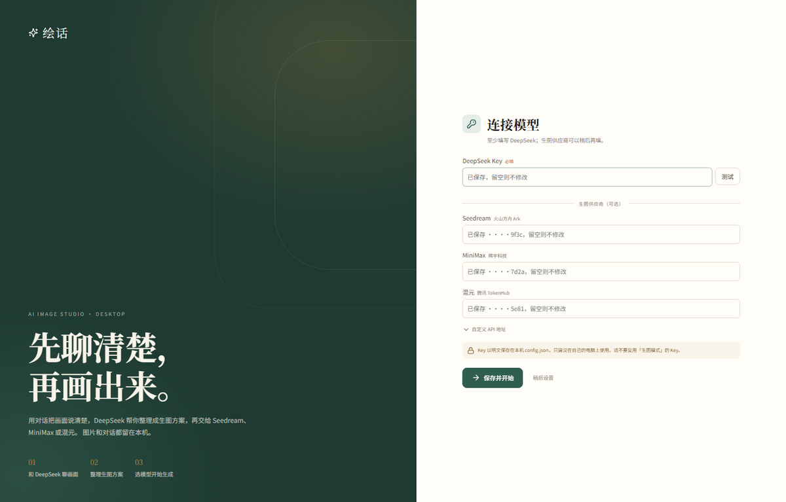
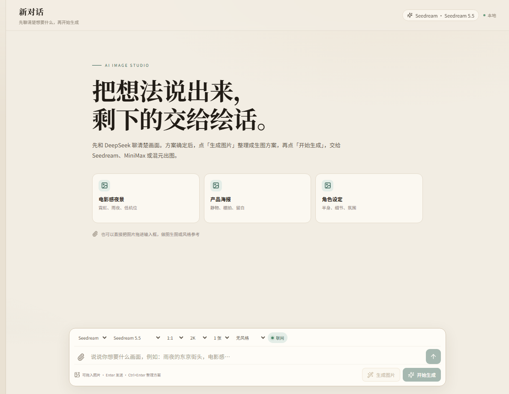
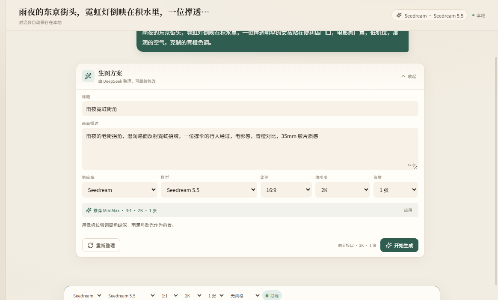
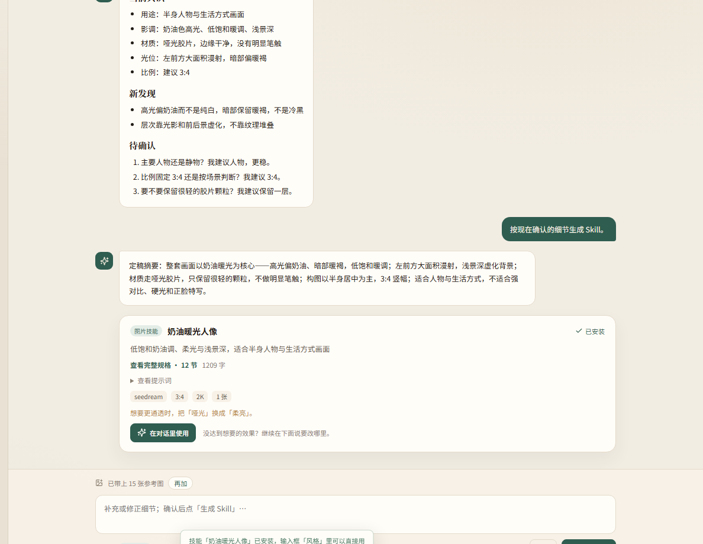
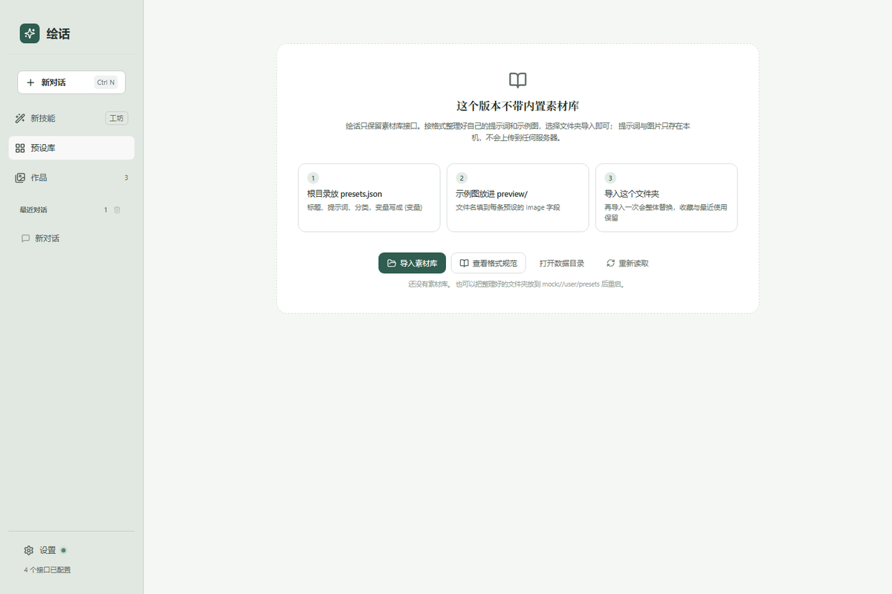
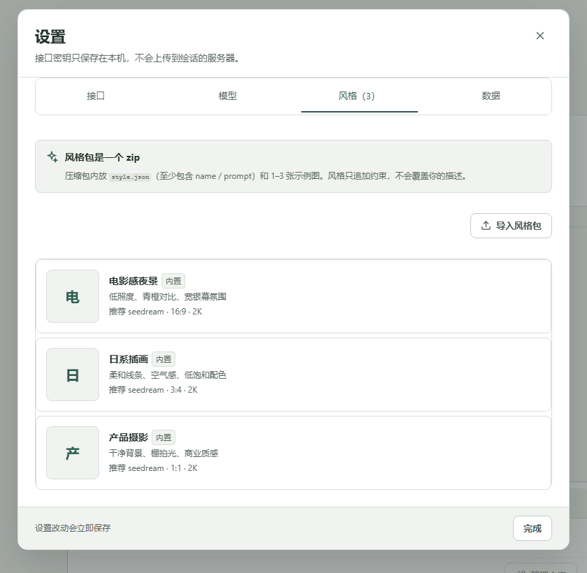

<div align="center">


<h1>绘话 · 把对话聊成一张图</h1>

<p><strong>先说清楚想要什么，再决定怎么画。</strong><br/>
桌面端 AI 生图工作台：对话厘清画面 → 整理成可修改的生图方案 → 交给 Seedream / MiniMax / 混元出图。</p>

<p>


</p>

</div>

> 图为按本文示例提示词生成的效果示意：**"雨夜的老街拐角，湿润路面反射霓虹招牌，一位撑伞的行人经过，电影感，青橙对比，35mm 胶片质感"**，16:9 / 2K。

---

## 为什么需要它

直接对生图模型喊一句话，通常要来回改七八次：构图不对、光线不对、风格跑偏。问题不在模型，在于**你还没想清楚要什么，就已经开始画了**。

绘话把这件事拆成三步，并且把中间那步做成看得见、改得动的东西：

| 步骤 | 你做什么 | 绘话做什么 |
| --- | --- | --- |
| ① 聊 | 用大白话描述：谁、在哪、什么光、什么氛围 | DeepSeek 追问缺口，把模糊的描述聊成具体的光线、构图、材质 |
| ② 定 | 在方案卡上改标题、改画面描述、换模型、换比例 | 生成一张**生图方案**：画面描述 + 参数 + 一句专业建议 + 一个更合适的模型推荐 |
| ③ 出 | 点「开始生成」 | 调你配置的生图接口出图，原图当场落盘到本地作品库 |

中间那张方案卡是关键：它是**可编辑的最终提示词**，不是一次性的聊天记录。改一个词、换一个比例，再点生成，不用重新聊一遍。

## 三步上手

### 1. 填 Key：只填你自己的



首次启动是引导页。**必填的只有 DeepSeek Key**，用来做对话和整理方案；三家生图供应商（Seedream / MiniMax / 混元）可以稍后再填，也可以只填其中一家。

- Key 只存在本机的 `%APPDATA%\绘话\config.json`，不会上传到本项目或任何第三方服务器；
- 输入框里已保存的 Key 只显示末几位，留空保存等于不修改；
- DeepSeek 那一栏有「测试」按钮，填完先点一下确认能连通；
- 展开「自定义 API 地址」可以给任意一家改 `base_url`，指向自建代理或中转。

> 想换别的兼容 OpenAI 协议的对话模型？在「设置 → 接口」里改地址即可；对话模型名固定走 `deepseek-flash`。

### 2. 说人话：把画面聊清楚



新建对话，直接把想法丢进去：

- 嫌打字麻烦就**拖图进来**——图片同时作为生图参考图，文档作为对话上下文；
- 也可以点「电影感夜景 / 产品海报 / 角色设定」这三个起手式，它会给你一段可改的示范描述；
- 每次回复首轮之后，DeepSeek 会自动给这条对话起一个短标题，侧栏一眼能找到。

聊得差不多了，点输入框旁边的 **「整理文案」**。

### 3. 改方案：在卡片上定稿，再出图



方案卡上你能做的事：

- **改「标题」和「画面描述」**——这就是最终发给生图模型的提示词，逐字可改；
- **换供应商、模型、比例、清晰度、张数**——五列下拉，选中即生效；
- 看 **「推荐 MiniMax · 3:4 · 2K · 1 张」** 这类建议——它按画面类型给一个更合适的组合，点「应用」一键套用；
- 点 **「重新整理」** 让 DeepSeek 重写一版，或者直接在下方输入框继续聊、让它改。

确认无误，点 **「开始生成」**。图片链接有时效，绘话在生成完的第一时间就把原图下载到本地，所以过几天再看作品库，图还在。

## 它和"直接调 API 生图"的区别

| 能力 | 说明 |
| --- | --- |
| **会追问的对话** | 描述里缺光位、缺景别、缺材质时，DeepSeek 会先问清楚，而不是拿一句模糊的话去赌 |
| **可编辑的方案卡** | 提示词、参数、模型全部在卡片上定稿，能改能存能复用；不是一次性的 prompt |
| **三家供应商并排** | Seedream 5.5 / 5.0 Pro / Flash、MiniMax H3 与高速版、混元 3.5，同一套参数面板切换；模型目录还会探测接口自动补全 |
| **每一步都留痕** | 作品库按供应商筛选、预览、导出、打开所在目录；删除进「最近删除」，30 天内可还原 |
| **完全本地** | 对话在 IndexedDB，图片在 `%APPDATA%\绘话\images`，作品和配置都不经过本项目的服务器 |
| **4.4 MB** | Tauri 2 + 系统 WebView2，不打包 Chromium，安装包只有几 MB |

## 进阶：教它一套你自己的风格



侧栏的 **「新技能」** 是创意工坊：上传几张风格参考图（不限张数，会自动压缩并按每请求最多 6 张分批上传），它会按固定清单逐项拆解——作品判读、色彩合同、光与明度、笔触材质、构图语法、细节规则、世界观、边界禁用、新细节决策、提示词骨架、验收标准。

- 分析阶段只更新「当前共识 / 新发现 / 待确认」三类结论，**不会**急着出成品；
- 你说「就按这个来」，它才生成一份 12 节、1500–3000 字的完整规格，并自动装进「设置 → 风格」；
- 之后每次生成都可以挂这套风格，出图稳定在同一套色号、光位和构图里。

工坊用的是 DeepSeek 的最高思考强度（`max`），对话与整理文案是 `high`——这是后端固定的，前端不暴露这个开关，省得你在不该调的地方调。

## 素材库：自带你自己的配方



这个开源版本**不内置任何第三方提示词和示例图**——那些内容的版权不属于本项目，所以出厂时预设库是空的。你可以把自己的配方整理成一个文件夹导进来：

```
my-library/
├── presets.json          # 标题、提示词、分类、变量
└── preview/              # 每条预设对应的示例图
    ├── poster-01.png
    └── poster-02.png
```

导入后功能与完整版一致：搜索、收藏、最近使用、变量填空、比例优先、四种出口（在对话里使用 / 直接生成 / 适配当前模型 / 装进风格库）。格式字段、体积上限和变量规则见 **[docs/LIBRARY_FORMAT.md](docs/LIBRARY_FORMAT.md)**，仓库里有一份可直接导入的模板：**[examples/library-template/](examples/library-template/)**。

风格包则是另一条路：「设置 → 风格」里可以导入 `.zip`（内含 `style.json` + 1–3 张示例图），风格只追加约束，不覆盖你在方案卡里写的描述。



## 数据与隐私

| 内容 | 位置 |
| --- | --- |
| 配置与 Key | `%APPDATA%\绘话\config.json` |
| 图片 | `%APPDATA%\绘话\images\YYYY-MM\` |
| 缩略图 | `%APPDATA%\绘话\thumbs\` |
| 风格包 | `%APPDATA%\绘话\styles\` |
| 对话 | 渲染进程 IndexedDB |
| 最近删除 | `%APPDATA%\绘话\trash\`（30 天自动清理） |

本项目没有服务端。除了你配置的 DeepSeek 与生图接口，没有任何数据外发；Key 以明文存在本机配置文件里，所以请不要在共享电脑上保存公司或团队的 Key。开发构建的审计结论见 **[docs/SECURITY.md](docs/SECURITY.md)**。

## 从源码构建

需要 **Node.js 20+**、**Rust 1.90+**、**WebView2 Runtime**（Win11 自带）与 Visual Studio C++ 生成工具。

```powershell
git clone https://github.com/nhh311/huihua.git
cd huihua
npm install

npm run dev            # 开发模式（rspack + Tauri 窗口）
npm run build:open     # 开源版安装包，约 4.4 MB，不含内置素材库
npm run build          # 完整版安装包，会打包 src-tauri/resources/presets/
npm run build:portable # 只出单文件 exe：src-tauri\target\release\huihua.exe
```

只调前端时可以 `npm run dev:renderer`，浏览器打开 `http://localhost:8090`（交互会走 mock 层）。

打包 NSIS 时 Tauri 需要联网下载工具链，国内直连 GitHub 超时的话：

```powershell
$env:TAURI_BUNDLER_TOOLS_GITHUB_MIRROR='https://gh-proxy.com/'
npm run build
```

发布构建已开启符号剥离与路径重映射（`src-tauri/Cargo.toml` 的 `[profile.release]`）。想彻底保证二进制里不留开发机的绝对路径，用 `npm run build:open` 打包即可——它会在构建后自动执行 `tools/scrub_paths.py` 兜底清理；手动构建时等价于：

```powershell
$env:RUSTFLAGS = "--remap-path-prefix=$PWD=. --remap-path-prefix=$env:USERPROFILE=."
npm run build:open
python tools/scrub_paths.py src-tauri\target\release\huihua.exe
```

自检：`python tools/scrub_paths.py <exe>` 输出 `total: 0` 且二进制里搜不到 `C:\Users\` 即通过，详见 **[docs/SECURITY.md](docs/SECURITY.md)**。

## 常见问题

**安装时 Windows 提示"已保护你的电脑"？**
安装包没有代码签名，点「更多信息 → 仍要运行」即可。开源项目自签证书反而会引入新的信任问题，这里选择如实说明。

**提示接口不通？**
先确认 Key 填对、`base_url` 是该供应商的地址。DeepSeek 那一栏可以直接点「测试」；生图三家要真出一张图才知道通不通——建议先用 1 张、1K 试。混元走腾讯 TokenHub，Seedream 走火山方舟，MiniMax 走 MiniMax 开放平台，三家是三个不同的 Key。

**为什么有些参数不能改？**
思考强度（对话与整理文案 `high`、创意工坊 `max`）在 Rust 侧固定；水印强制关闭；负面提示词 Seedream / MiniMax / 混元均不支持；`seed` 只有混元支持。这些是供应商能力差异，不是漏做。

**生成的图过几天打不开了？**
接口返回的图片链接有时效，但绘话在生成时就会下载原图到 `%APPDATA%\绘话\images`，作品库里的就是本地原图。如果你是通过接口直接拿链接用图，请自行转存。

**能装 macOS / Linux 吗？**
当前只面向 Windows 10/11 x64。Tauri 的跨平台能力在，但路径、托盘、安装器都是按 Windows 写的，需要单独适配。

## 目录结构

```
huihua/
├── src/                      # React 18 前端（App / Chat / Presets / Workshop / Gallery）
├── src-tauri/
│   ├── src/                  # Rust 侧：deepseek / providers / planner / presets / gallery / styles
│   ├── capabilities/         # Tauri 权限声明
│   ├── tauri.conf.json       # 默认构建（含内置预设）
│   ├── tauri.open.conf.json  # 开源构建（bundle.resources 置空）
│   └── Cargo.toml
├── docs/
│   ├── LIBRARY_FORMAT.md     # 素材库格式规范
│   ├── OPEN_SOURCE.md        # 开源前检查清单
│   └── SECURITY.md           # 构建产物审计结论
├── examples/library-template/  # 可直接导入的素材库模板
├── assets/                   # README 截图
├── tools/
│   ├── scrub_paths.py        # 发布前抹掉二进制里的本机绝对路径
│   └── prepare_repo.py       # 发布前把第三方素材与构建产物移出工作区
├── test/                     # 无头浏览器 CDP 回归脚本
├── installer.nsi             # 自定义 NSIS 安装脚本
└── package.json
```

## 协议

代码以 **MIT** 协议开源，见 [LICENSE](LICENSE)。仓库内的第三方依赖各自遵循其原始协议；README 中出现的界面截图与示例图由本项目生成或截取，不含第三方素材。

如果你打算二次分发或商用，请先看 **[docs/OPEN_SOURCE.md](docs/OPEN_SOURCE.md)**——里面列了发布前必须处理的事项（内置素材库、构建产物、本机数据、第三方声明）。`python tools/prepare_repo.py` 会按那份清单把第三方素材与构建产物一次性移出工作区，默认只预演、加 `--apply` 才执行。
